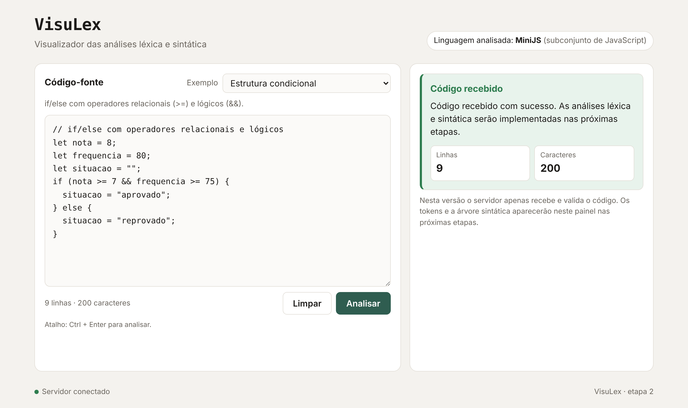

# VisuLex

Software educacional web para o ensino de **Compiladores**. O objetivo é mostrar, passo a passo, as análises **léxica** e **sintática** de programas escritos em **MiniJS**, um subconjunto da linguagem JavaScript, para estudantes de graduação.

> **Etapa atual: 2 — interface web e entrada de código-fonte.** O usuário escreve ou escolhe um programa, solicita a análise e o servidor **recebe e valida** o código, devolvendo um resumo (linhas e caracteres). As análises léxica e sintática **ainda não estão implementadas**; elas serão adicionadas nas próximas etapas.



## Sumário

- [Linguagem analisada](#linguagem-analisada)
- [Tecnologias e arquitetura](#tecnologias-e-arquitetura)
- [Como executar](#como-executar)
- [Como usar a interface](#como-usar-a-interface)
- [Exemplos disponíveis](#exemplos-disponíveis)
- [Comunicação entre frontend e backend](#comunicação-entre-frontend-e-backend)
- [Testes](#testes)
- [Limitações conhecidas](#limitações-conhecidas)

## Linguagem analisada

**Linguagem escolhida:** JavaScript, limitada ao subconjunto **MiniJS**.

**Subconjunto previsto:** declarações com `let` e `const`; números, strings e booleanos; operadores aritméticos (`+ - * / %`), relacionais (`== != === !== < <= > >=`) e lógicos (`&& || !`); atribuição; `if/else`; `while`; funções simples com `function` e `return`; comentários `//` e `/* */`. A especificação completa está em [`docs/minijs.md`](docs/minijs.md).

**Por que JavaScript:** é a linguagem que os alunos já usam no desenvolvimento web, o que concentra o esforço nos conceitos de compilação e não na sintaxe; a mesma linguagem é usada para construir a ferramenta; e os trabalhos encontrados na revisão de literatura analisam pseudolinguagens ou linguagens criadas só para a disciplina.

**Por que um subconjunto:** JavaScript completo tem casos difíceis para um primeiro analisador, como o ponto e vírgula opcional e a ambiguidade entre divisão e expressão regular. Em MiniJS o `;` é obrigatório e esses recursos ficam de fora.

## Tecnologias e arquitetura

| Componente | Tecnologia | Papel |
| --- | --- | --- |
| Frontend | HTML, CSS e JavaScript puros (módulos ES), servidos pelo **Nginx 1.27** | Interface, validação inicial e envio do código |
| Backend | **Node.js 22**, apenas módulos nativos (sem dependências) | API, validação e processamento do código |
| Testes | `node:test` (nativo) e **Playwright 1.56** (`playwright-core`) com Chromium | Unitários, endpoints, interface, ponta a ponta e implantação |
| Ambiente | **Docker** e **Docker Compose** | Execução reproduzível dos serviços e dos testes |

```
Navegador ──► frontend (Nginx, porta 8080)
                 ├── /        → arquivos estáticos (index.html, styles.css, js/)
                 └── /api/*   → repassa para ──► backend (Node.js, porta 3000, só na rede interna)
```

O navegador usa sempre o mesmo endereço (`/api/...`) e o Nginx repassa ao serviço `backend` pela rede interna do Compose. Assim o frontend não depende de nomes que só existem dentro do Docker.

### Estrutura de pastas

```
visulex/
├── backend/
│   ├── src/
│   │   ├── app.js            # rotas, leitura do corpo e tratamento de erros
│   │   ├── validacao.js      # regras de validação da requisição
│   │   ├── processamento.js  # processamento do código (receberá os analisadores)
│   │   ├── erros.js          # erros previstos e mensagem genérica
│   │   └── server.js         # inicia o servidor
│   └── test/                 # unitários, endpoints e regressão (node:test)
├── frontend/
│   ├── public/
│   │   ├── index.html
│   │   ├── styles.css
│   │   └── js/
│   │       ├── exemplos.js   # programas de exemplo
│   │       ├── validacao.js  # validação antes do envio
│   │       ├── api.js        # comunicação com o backend
│   │       ├── interface.js  # comportamento da tela
│   │       └── main.js       # ponto de entrada
│   ├── test/
│   │   ├── unit/             # unitários (node:test)
│   │   └── ui/               # interface e integração no navegador (Playwright)
│   └── nginx.conf
├── testes/
│   └── implantacao.test.mjs  # verificações da aplicação implantada
├── scripts/
│   └── executar-testes.mjs   # roda todas as suítes e mostra um resumo
├── docs/
│   ├── minijs.md             # especificação do subconjunto
│   ├── testes.md             # registro das execuções de testes
│   └── img/                  # prints da interface
└── docker-compose.yml
```

## Como executar

### Pré-requisitos

| Ferramenta | Versão mínima | Como conferir |
| --- | --- | --- |
| Docker Engine (ou Docker Desktop) | 24 | `docker --version` |
| Docker Compose (plugin v2) | 2.20 | `docker compose version` |
| Git | qualquer recente | `git --version` |

Node.js **não** é necessário para executar a aplicação nem os testes pelo Docker. A interface usa a porta **8080**. Se ela estiver ocupada por outro programa (o `docker compose up` falha com "Ports are not available"), escolha outra porta com `FRONTEND_PORT`: veja [Variáveis de ambiente](#variáveis-de-ambiente).

### Iniciar

```bash
git clone https://github.com/<seu-usuario>/visulex.git
cd visulex
docker compose up --build -d
docker compose ps        # backend e frontend devem aparecer como "healthy"
```

### Acessar

Abra **http://localhost:8080** no navegador. O rodapé deve mostrar **Servidor conectado**.

### Encerrar

```bash
docker compose down              # para e remove os contêineres e a rede
docker compose down --rmi local  # (opcional) remove também as imagens do projeto
```

### Variáveis de ambiente

| Variável | Padrão | Uso |
| --- | --- | --- |
| `FRONTEND_PORT` | `8080` | Porta da interface na sua máquina. Para trocar, copie `.env.example` para `.env` e altere o valor (ex.: `FRONTEND_PORT=8081`); a interface passa a ficar em `http://localhost:8081`. |
| `PORT` (backend) | `3000` | Porta interna do backend, definida no `docker-compose.yml`. |

Nenhuma senha, token ou credencial é necessária.

## Como usar a interface

- **Área de código:** campo com fonte monoespaçada para escrever, colar ou editar um programa. Abaixo dele, um contador mostra linhas e caracteres. O conteúdo permanece no campo depois de cada análise.
- **Exemplo:** o seletor no topo carrega um programa pronto no campo, **substituindo** o conteúdo atual, e mostra uma descrição. O exemplo pode ser editado antes da análise.
- **Analisar:** envia o código ao servidor. O atalho **Ctrl + Enter** faz o mesmo. Durante o envio o botão fica desabilitado.
- **Limpar:** esvazia o campo e reinicia o seletor e os resultados.
- **Resultado:** mostra a resposta com cores e títulos diferentes para cada situação:

| Situação | Título exibido | Exemplo de mensagem |
| --- | --- | --- |
| Código recebido | Código recebido | "Código recebido com sucesso. As análises léxica e sintática serão implementadas nas próximas etapas." + linhas e caracteres |
| Campo vazio | Problema na entrada | "Informe um código-fonte antes de solicitar a análise." |
| Só espaços | Problema na entrada | "O código contém apenas espaços em branco. Escreva ou selecione um programa MiniJS." |
| Servidor inacessível | Falha de comunicação | "Não foi possível comunicar com o servidor. Verifique a conexão e tente novamente." |
| Erro no servidor | Erro inesperado | "Ocorreu um erro inesperado. Tente novamente em instantes." |

Entradas vazias ou só com espaços são barradas no próprio navegador, sem requisição. O backend repete todas as validações.

## Exemplos disponíveis

| Exemplo | Construções de MiniJS demonstradas |
| --- | --- |
| Declaração de variáveis | `let`, `const`, números inteiros e decimais, strings, booleanos, atribuição |
| Expressões aritméticas | `+ - * / %`, precedência de operadores, parênteses |
| Estrutura condicional | `if/else`, operadores relacionais (`>=`) e lógicos (`&&`), blocos |
| Repetição com while | `while`, operadores relacionais, atribuição, comentários |
| Declaração e chamada de função | `function`, parâmetros, `return`, chamada de função, `if` |
| Programa com erros intencionais ⚠ | erro léxico (símbolo `@`) e erro sintático (falta `;`), para as próximas etapas |

Os programas ficam em [`frontend/public/js/exemplos.js`](frontend/public/js/exemplos.js).

## Comunicação entre frontend e backend

### `POST /api/analisar`

Requisição (`Content-Type: application/json`):

```json
{ "codigo": "let x = 10;" }
```

Resposta de sucesso — **200**:

```json
{
  "recebido": true,
  "mensagem": "Código recebido com sucesso. As análises léxica e sintática serão implementadas nas próximas etapas.",
  "resumo": { "caracteres": 11, "linhas": 1 }
}
```

Resposta de erro — sempre no formato:

```json
{ "erro": { "codigo": "CODIGO_VAZIO", "mensagem": "Informe um código-fonte antes de solicitar a análise." } }
```

| HTTP | `erro.codigo` | Quando |
| --- | --- | --- |
| 400 | `CORPO_VAZIO` | Requisição sem corpo |
| 400 | `JSON_INVALIDO` | Corpo não é JSON válido |
| 400 | `CORPO_INVALIDO` | JSON não é um objeto (ex.: lista) |
| 400 | `CODIGO_AUSENTE` | Falta o campo `codigo` |
| 400 | `CODIGO_TIPO_INVALIDO` | `codigo` não é texto |
| 400 | `CODIGO_VAZIO` | `codigo` é `""` |
| 400 | `CODIGO_SO_ESPACOS` | `codigo` só tem espaços, tabulações ou quebras de linha |
| 400 | `CODIGO_MUITO_GRANDE` | Mais de 10.000 caracteres |
| 404 | `ROTA_NAO_ENCONTRADA` | Caminho que não existe na API (vale para qualquer rota) |
| 405 | `METODO_NAO_PERMITIDO` | Método diferente de POST (cabeçalho `Allow: POST`) |
| 413 | `PAYLOAD_MUITO_GRANDE` | Corpo acima de 64 KB |
| 415 | `CONTENT_TYPE_INVALIDO` | `Content-Type` diferente de `application/json` |
| 500 | `ERRO_INTERNO` | Falha inesperada; a mensagem é genérica e os detalhes ficam só no log do servidor |

Código com erros de MiniJS (por exemplo, `let = @@`) é **aceito** nesta etapa: julgar a sintaxe é papel dos analisadores das próximas etapas.

### Outras rotas

| Rota | Resposta |
| --- | --- |
| `GET /api/health` | `{ "status": "ok" }` — usada pelo healthcheck do Docker e pelo indicador do rodapé |
| `GET /api/hello` | `{ "message": "Hello, World!" }` — mantida da etapa 1 e coberta por teste de regressão |

## Testes

### Suítes

| Suíte | Tipo | Ferramenta | Quantidade |
| --- | --- | --- | --- |
| `backend/test/` | Unitários, endpoints e regressão | `node:test` | 35 |
| `frontend/test/unit/` | Unitários (exemplos, validação, cliente da API) | `node:test` | 27 |
| `frontend/test/ui/` | Interface e integração no navegador (backend real); ponta a ponta quando `BASE_URL` aponta para a aplicação implantada | `node:test` + Playwright | 25 |
| `testes/implantacao.test.mjs` | Implantação: aplicação acessível, proxy, saúde e validação via Nginx | `node:test` | 7 |

### Como executar

**Pelo Docker (recomendado, não exige Node.js):**

```bash
docker compose up --build -d
docker compose --profile test run --rm testes
```

O serviço `testes` usa a imagem oficial do Playwright, roda as quatro suítes contra a aplicação em execução e termina com um resumo `PASSOU/FALHOU`. Na primeira execução ele baixa o pacote `playwright-core`, então precisa de internet.

**Localmente (Node.js 22 ou superior):**

```bash
cd frontend
npm install
npx playwright-core install chromium
cd ..
node scripts/executar-testes.mjs                                   # backend, frontend e interface
BASE_URL=http://localhost:8080 node scripts/executar-testes.mjs    # inclui implantação (com o Compose no ar)
```

No PowerShell, defina a variável antes: `$env:BASE_URL="http://localhost:8080"; node scripts/executar-testes.mjs`.

### Resultados

Na última execução registrada (20/10/2026, com o Docker Compose real: `docker compose --profile test run --rm testes`), **94 de 94 testes passaram** (35 backend, 27 frontend, 25 interface e 7 de implantação). O histórico completo, incluindo as falhas encontradas e como foram corrigidas, está em [`docs/testes.md`](docs/testes.md).

### Validação de instalação limpa

```bash
docker compose down --rmi local --remove-orphans
cd /tmp && rm -rf visulex-teste
git clone https://github.com/<seu-usuario>/visulex.git visulex-teste && cd visulex-teste
docker compose up --build -d
docker compose --profile test run --rm testes
docker compose down --rmi local
```

## Limitações conhecidas

- As análises léxica e sintática **não estão implementadas**. O servidor só recebe, valida e resume o código.
- O editor é um campo de texto simples, sem realce de sintaxe nem numeração de linhas.
- Escolher um exemplo substitui o código atual sem pedir confirmação.
- O código é limitado a 10.000 caracteres.
- O indicador "Servidor conectado" é verificado só ao abrir a página. Falhas posteriores aparecem ao clicar em Analisar.
- Os testes pelo Docker precisam de internet na primeira execução, para baixar o `playwright-core`.

## Roadmap

- [x] Etapa 1 — estrutura, Docker e "Hello, World!"
- [x] Etapa 2 — interface, exemplos, comunicação, validações e testes automatizados
- [ ] Analisador léxico de MiniJS com autômato animado
- [ ] Analisador sintático LL(1) com construção passo a passo da árvore
- [ ] Explicações teóricas
- [ ] Avaliação com alunos (pré e pós-teste)
