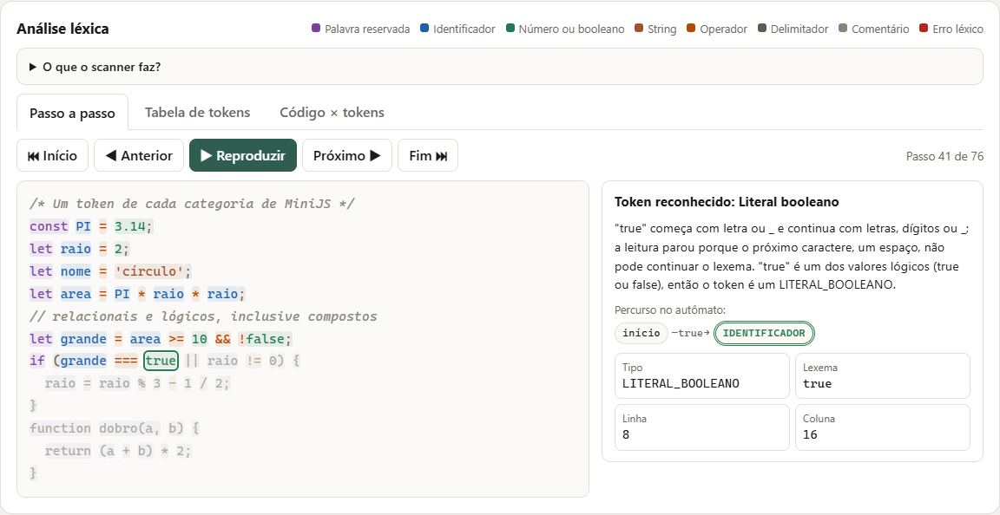

# VisuLex

Software educacional web para o ensino de **Compiladores**. O objetivo é mostrar, passo a passo, as análises **léxica** e **sintática** de programas escritos em **MiniJS**, um subconjunto da linguagem JavaScript, para estudantes de graduação.

> **Etapa atual: 3 — análise léxica (scanner).** O usuário escreve ou escolhe um programa e solicita a análise. O backend valida o código, executa o **analisador léxico** e devolve os tokens (categoria, lexema, linha e coluna), os erros léxicos e o percurso do scanner. A interface mostra os tokens em tabela, o código colorido por categoria, os erros com localização e um **passo a passo** do scanner, com os estados do autômato. A **análise sintática ainda não está implementada**: ela é a etapa 4.



## Sumário

- [Linguagem analisada](#linguagem-analisada)
- [Tecnologias e arquitetura](#tecnologias-e-arquitetura)
- [Como executar](#como-executar)
- [Analisador léxico](#analisador-léxico)
- [Como usar a interface](#como-usar-a-interface)
- [Exemplos disponíveis](#exemplos-disponíveis)
- [Comunicação entre frontend e backend](#comunicação-entre-frontend-e-backend)
- [Testes](#testes)
- [Limitações conhecidas](#limitações-conhecidas)

## Linguagem analisada

**Linguagem escolhida:** JavaScript, limitada ao subconjunto **MiniJS**.

**Por que JavaScript:** é a linguagem que os alunos já usam no desenvolvimento web, o que concentra o esforço nos conceitos de compilação e não na sintaxe; a mesma linguagem é usada para construir a ferramenta; e os trabalhos encontrados na revisão de literatura analisam pseudolinguagens ou linguagens criadas só para a disciplina.

**Por que um subconjunto:** JavaScript completo tem casos difíceis para um primeiro analisador, como o ponto e vírgula opcional e a ambiguidade entre divisão e expressão regular. Em MiniJS o `;` é obrigatório e esses recursos ficam de fora.

### Escopo léxico

| Categoria (`tipo` do token) | Exemplos | Regra |
| --- | --- | --- |
| `PALAVRA_RESERVADA` | `let` `const` `if` `else` `while` `function` `return` | Só essas 7, em minúsculas |
| `IDENTIFICADOR` | `numero`, `_x1`, `valor2`, `ação` | Letra ou `_`, seguida de letras, dígitos ou `_` |
| `LITERAL_INTEIRO` | `0`, `10`, `42` | Dígitos |
| `LITERAL_REAL` | `3.14`, `0.5` | Dígitos, ponto, dígitos |
| `LITERAL_STRING` | `"texto"`, `'Ana'`, `"a\"b"` | Entre aspas, na mesma linha, com escape `\` |
| Literal de caractere | — | Não existe: JavaScript não tem tipo caractere, e `'a'` é um `LITERAL_STRING` de tamanho 1 |
| `LITERAL_BOOLEANO` | `true`, `false` | Reservados: não podem ser nomes |
| `OPERADOR_ARITMETICO` | `+` `-` `*` `/` `%` | |
| `OPERADOR_RELACIONAL` | `==` `!=` `===` `!==` `<` `<=` `>` `>=` | Sempre o maior possível (`>=` é um token) |
| `OPERADOR_LOGICO` | `&&` `\|\|` `!` | `&` e `\|` sozinhos são erro |
| `OPERADOR_ATRIBUICAO` | `=` | |
| `DELIMITADOR` | `(` `)` `{` `}` `,` `;` | Não há colchetes (sem arrays) |
| Comentários | `// linha` e `/* bloco */` | Descartados, não geram token |
| Espaços em branco | espaço, tabulação, quebras de linha | Descartados, só separam lexemas |
| Caracteres não reconhecidos | `@`, `#`, `$`, `[`, `` ` `` | Erro léxico com linha e coluna; o scanner continua |

As regras completas, os erros léxicos e os estados do autômato estão em [`docs/minijs.md`](docs/minijs.md).

## Tecnologias e arquitetura

| Componente | Tecnologia | Papel |
| --- | --- | --- |
| Frontend | HTML, CSS e JavaScript puros (módulos ES), servidos pelo **Nginx 1.27** | Interface, validação inicial, envio do código e visualização dos tokens |
| Backend | **Node.js 22**, apenas módulos nativos (sem dependências) | API, validação e **analisador léxico** |
| Testes | `node:test` (nativo) e **Playwright 1.56** (`playwright-core`) com Chromium | Unitários, endpoints, interface, ponta a ponta e implantação |
| Ambiente | **Docker** e **Docker Compose** | Execução reproduzível dos serviços e dos testes |

```
Navegador ──► frontend (Nginx, porta 8080)
                 ├── /        → arquivos estáticos (index.html, styles.css, js/)
                 └── /api/*   → repassa para ──► backend (Node.js, porta 3000, só na rede interna)
                                                   └── validação → analisador léxico → resposta JSON
```

O navegador usa sempre o mesmo endereço (`/api/...`) e o Nginx repassa ao serviço `backend` pela rede interna do Compose. Assim o frontend não depende de nomes que só existem dentro do Docker.

### Estrutura de pastas

```
visulex/
├── backend/
│   ├── src/
│   │   ├── app.js              # rotas, leitura do corpo e tratamento de erros
│   │   ├── validacao.js        # regras de validação da requisição
│   │   ├── analisadorLexico.js # scanner de MiniJS (tokens, erros e passos)
│   │   ├── processamento.js    # executa o scanner e monta a resposta
│   │   ├── erros.js            # erros previstos e mensagem genérica
│   │   └── server.js           # inicia o servidor
│   └── test/                   # scanner, endpoints e regressão (node:test)
├── frontend/
│   ├── public/
│   │   ├── index.html
│   │   ├── styles.css
│   │   └── js/
│   │       ├── exemplos.js     # programas de exemplo
│   │       ├── validacao.js    # validação antes do envio
│   │       ├── api.js          # comunicação com o backend
│   │       ├── lexico.js       # funções de exibição dos tokens (cores, trechos, contagens)
│   │       ├── interface.js    # comportamento da tela e passo a passo
│   │       └── main.js         # ponto de entrada
│   ├── test/
│   │   ├── unit/               # unitários (node:test)
│   │   └── ui/                 # interface e integração no navegador (Playwright)
│   └── nginx.conf
├── testes/
│   └── implantacao.test.mjs    # verificações da aplicação implantada
├── scripts/
│   └── executar-testes.mjs     # roda todas as suítes e mostra um resumo
├── docs/
│   ├── minijs.md               # especificação léxica e sintática de MiniJS
│   ├── testes.md               # registro das execuções de testes
│   └── img/                    # prints da interface
└── docker-compose.yml
```

## Como executar

### Pré-requisitos

| Ferramenta | Versão mínima | Como conferir |
| --- | --- | --- |
| Docker Engine (ou Docker Desktop) | 24 | `docker --version` |
| Docker Compose (plugin v2) | 2.20 | `docker compose version` |
| Git | qualquer recente | `git --version` |

Node.js **não** é necessário para executar a aplicação nem os testes pelo Docker. A interface usa a porta **8080**. Se ela estiver ocupada por outro programa (o `docker compose up` falha com "Ports are not available"), escolha outra porta com `FRONTEND_PORT`: veja [Variáveis de ambiente](#variáveis-de-ambiente).

### Iniciar

```bash
git clone https://github.com/pvdcm/Trabalho_Compiladores.git
cd Trabalho_Compiladores
docker compose up --build -d
docker compose ps        # backend e frontend devem aparecer como "healthy"
```

### Acessar

Abra **http://localhost:8080** no navegador. O rodapé deve mostrar **Servidor conectado**.

### Encerrar

```bash
docker compose down              # para e remove os contêineres e a rede
docker compose down --rmi local  # (opcional) remove também as imagens do projeto
```

### Variáveis de ambiente

| Variável | Padrão | Uso |
| --- | --- | --- |
| `FRONTEND_PORT` | `8080` | Porta da interface na sua máquina. Para trocar, copie `.env.example` para `.env` e altere o valor (ex.: `FRONTEND_PORT=8081`); a interface passa a ficar em `http://localhost:8081`. |
| `PORT` (backend) | `3000` | Porta interna do backend, definida no `docker-compose.yml`. |

Nenhuma senha, token ou credencial é necessária. A etapa 3 não acrescentou variáveis, portas nem dependências.

## Analisador léxico

**Implementação:** scanner escrito à mão em JavaScript, no backend ([`backend/src/analisadorLexico.js`](backend/src/analisadorLexico.js)), sem bibliotecas nem geradores. Ele percorre o código caractere a caractere, agrupa os caracteres em lexemas, classifica cada lexema em uma categoria e registra linha e coluna. Espaços e comentários são descartados. Erros léxicos são registrados com localização e a leitura continua, para mostrar todos os problemas de uma vez. A análise para depois de 100 erros.

**Por que escrever à mão, e não usar um gerador (Flex, JFlex, ANTLR):** um gerador produz um autômato que o aluno não vê. Escrito à mão, cada lexema é reconhecido por um autômato explícito, e o scanner registra o estado alcançado a cada caractere lido. A interface usa esse registro para mostrar o percurso no autômato e explicar por que cada lexema terminou onde terminou. Além disso, o projeto continua sem dependências, e o scanner usa a mesma linguagem do resto do sistema.

**Por que no backend:** o enunciado pede que o endpoint de análise devolva os tokens. A interface só exibe o que o servidor calculou, e o mesmo módulo será a entrada do analisador sintático na etapa 4.

**Exemplo:** para `x = 12abc & 2;` o scanner produz os tokens `x`, `=`, `2` e `;` e dois erros: `12abc` (número malformado, coluna 5) e `&` (operador incompleto, coluna 11). O JSON completo está em [Comunicação entre frontend e backend](#comunicação-entre-frontend-e-backend).

## Como usar a interface

- **Área de código:** campo com fonte monoespaçada para escrever, colar ou editar um programa. Um contador mostra linhas e caracteres. As ligaduras de fonte ficam desligadas, para que `>=` apareça como dois caracteres, e não como `≥`.
- **Exemplo:** o seletor carrega um programa pronto, **substituindo** o conteúdo atual, e mostra uma descrição.
- **Analisar** (ou **Ctrl + Enter**): envia o código. Durante o envio o botão fica desabilitado.
- **Limpar:** esvazia o campo e reinicia o seletor e os resultados.
- **Resultado:** título e mensagem, totais (linhas, caracteres, tokens e erros léxicos), contagem de **tokens por categoria** e a lista de **erros léxicos** (clique em um erro para vê-lo no passo a passo).
- **Análise léxica** (abaixo do editor): uma explicação curta do que são scanner, lexema, token e autômato, a legenda de cores e três abas:
  - **Passo a passo:** o código colorido por categoria. Os botões Início, Anterior, Próximo, Fim e **Reproduzir** percorrem o código um lexema por vez: o lexema atual fica contornado, os já lidos ficam coloridos e os seguintes ficam apagados. Para cada passo aparecem a explicação (por que o lexema terminou ali e qual a categoria), o **percurso no autômato** (estados por caractere, com o estado de aceitação ou de erro) e a ficha do token (tipo, lexema, linha e coluna). Clicar em um trecho do código leva ao passo dele.
  - **Tabela de tokens:** colunas #, Tipo, Lexema, Linha e Coluna. Clicar em uma linha mostra o token no passo a passo.
  - **Código × tokens:** cada linha do código original ao lado da sequência ⟨tipo, lexema⟩ que o scanner produziu para ela.
- Se o código for editado depois da análise, um aviso indica que o resultado está desatualizado.
- **Celular:** a tela se reorganiza em uma coluna, os botões ficam maiores e as tabelas rolam dentro da própria caixa, sem rolagem horizontal da página.

| Situação | Título exibido | Exemplo de mensagem |
| --- | --- | --- |
| Sem erros léxicos | Análise léxica concluída | "Análise léxica concluída: 5 tokens reconhecidos e nenhum erro léxico." |
| Com erros léxicos | Erros léxicos encontrados | "Análise léxica concluída com 2 erros léxicos. Os demais trechos foram reconhecidos normalmente (4 tokens)." |
| Campo vazio | Problema na entrada | "Informe um código-fonte antes de solicitar a análise." |
| Só espaços | Problema na entrada | "O código contém apenas espaços em branco. Escreva ou selecione um programa MiniJS." |
| Servidor inacessível | Falha de comunicação | "Não foi possível comunicar com o servidor. Verifique a conexão e tente novamente." |
| Erro no servidor | Erro inesperado | "Ocorreu um erro inesperado. Tente novamente em instantes." |

Entradas vazias ou só com espaços são barradas no próprio navegador, sem requisição. O backend repete todas as validações.

## Exemplos disponíveis

| Exemplo | Construções de MiniJS demonstradas |
| --- | --- |
| Declaração de variáveis | `let`, `const`, números inteiros e decimais, strings, booleanos, atribuição |
| Expressões aritméticas | `+ - * / %`, precedência de operadores, parênteses |
| Estrutura condicional | `if/else`, operadores relacionais (`>=`) e lógicos (`&&`), blocos |
| Repetição com while | `while`, operadores relacionais, atribuição, comentários |
| Declaração e chamada de função | `function`, parâmetros, `return`, chamada de função, `if` |
| Todas as categorias de tokens | um token de cada uma das 11 categorias, operadores compostos (`>=` `===` `!=` `&&` `\|\|`) e os dois estilos de comentário |
| Programa com erros intencionais ⚠ | erro léxico (símbolo `@`) e erro sintático (falta `;`); o scanner só aponta o léxico |
| Erros léxicos variados ⚠ | número malformado, string não fechada, operador incompleto, colchetes e comentário não fechado |

Os programas ficam em [`frontend/public/js/exemplos.js`](frontend/public/js/exemplos.js). Um teste confere que os exemplos válidos não têm nenhum erro léxico e que os exemplos com erro produzem exatamente os erros anunciados.

## Comunicação entre frontend e backend

### `POST /api/analisar`

Requisição (`Content-Type: application/json`):

```json
{ "codigo": "let x = 10;" }
```

Resposta — **200**, sempre que a requisição é válida, mesmo que o programa tenha erros léxicos. Os erros são um resultado da análise, e não uma falha da requisição. O campo `sucesso` indica se houve erro léxico.

```json
{
  "sucesso": true,
  "mensagem": "Análise léxica concluída: 5 tokens reconhecidos e nenhum erro léxico.",
  "resumo": { "caracteres": 11, "linhas": 1, "tokens": 5, "erros": 0 },
  "tokens": [
    { "tipo": "PALAVRA_RESERVADA", "lexema": "let", "linha": 1, "coluna": 1, "inicio": 0, "fim": 3 },
    { "tipo": "IDENTIFICADOR", "lexema": "x", "linha": 1, "coluna": 5, "inicio": 4, "fim": 5 },
    { "tipo": "OPERADOR_ATRIBUICAO", "lexema": "=", "linha": 1, "coluna": 7, "inicio": 6, "fim": 7 },
    { "tipo": "LITERAL_INTEIRO", "lexema": "10", "linha": 1, "coluna": 9, "inicio": 8, "fim": 10 },
    { "tipo": "DELIMITADOR", "lexema": ";", "linha": 1, "coluna": 11, "inicio": 10, "fim": 11 }
  ],
  "erros": [],
  "passos": [
    {
      "acao": "TOKEN",
      "tipo": "PALAVRA_RESERVADA",
      "lexema": "let",
      "linha": 1, "coluna": 1, "inicio": 0, "fim": 3,
      "estados": ["IDENTIFICADOR", "IDENTIFICADOR", "IDENTIFICADOR"],
      "explicacao": "\"let\" começa com letra ou _ e continua com letras, dígitos ou _; a leitura parou porque o próximo caractere, um espaço, não pode continuar o lexema. Como \"let\" está na tabela de palavras reservadas, o token é uma PALAVRA_RESERVADA, e não um identificador."
    }
  ]
}
```

(em `passos` foi mostrado só o primeiro dos 5 itens)

Com erros léxicos, por exemplo `{ "codigo": "x = 12abc & 2;" }` (`passos` omitido):

```json
{
  "sucesso": false,
  "mensagem": "Análise léxica concluída com 2 erros léxicos. Os demais trechos foram reconhecidos normalmente (4 tokens).",
  "resumo": { "caracteres": 14, "linhas": 1, "tokens": 4, "erros": 2 },
  "tokens": [
    { "tipo": "IDENTIFICADOR", "lexema": "x", "linha": 1, "coluna": 1, "inicio": 0, "fim": 1 },
    { "tipo": "OPERADOR_ATRIBUICAO", "lexema": "=", "linha": 1, "coluna": 3, "inicio": 2, "fim": 3 },
    { "tipo": "LITERAL_INTEIRO", "lexema": "2", "linha": 1, "coluna": 13, "inicio": 12, "fim": 13 },
    { "tipo": "DELIMITADOR", "lexema": ";", "linha": 1, "coluna": 14, "inicio": 13, "fim": 14 }
  ],
  "erros": [
    {
      "tipo": "ERRO_LEXICO", "codigo": "NUMERO_MALFORMADO", "lexema": "12abc",
      "linha": 1, "coluna": 5, "inicio": 4, "fim": 9,
      "mensagem": "Erro léxico na linha 1, coluna 5: número malformado '12abc'. Um número tem só dígitos, com no máximo um ponto seguido de dígitos (ex.: 42 ou 3.14), e não pode vir colado a letras."
    },
    {
      "tipo": "ERRO_LEXICO", "codigo": "OPERADOR_INCOMPLETO", "lexema": "&",
      "linha": 1, "coluna": 11, "inicio": 10, "fim": 11,
      "mensagem": "Erro léxico na linha 1, coluna 11: símbolo '&' incompleto. Em MiniJS o operador lógico é '&&' (E)."
    }
  ]
}
```

| Campo | Conteúdo |
| --- | --- |
| `sucesso` | `true` se não houve erro léxico |
| `mensagem` | Resumo para o usuário |
| `resumo` | `caracteres`, `linhas`, `tokens` e `erros` (quantidades) |
| `tokens[]` | `tipo`, `lexema`, `linha`, `coluna`, `inicio`, `fim`. `inicio` e `fim` são índices de caractere no código (`fim` exclusivo), usados para destacar o trecho |
| `erros[]` | `tipo` (sempre `ERRO_LEXICO`), `codigo` (ver [`docs/minijs.md`](docs/minijs.md#erros-léxicos)), `lexema`, `linha`, `coluna`, `inicio`, `fim`, `mensagem` |
| `passos[]` | Um item por token, comentário ou erro, na ordem do código: `acao` (`TOKEN`, `IGNORADO` ou `ERRO`), `tipo`, `lexema`, posição, `estados` (estado do autômato depois de cada caractere) e `explicacao` |

Resposta de erro da requisição — sempre no formato:

```json
{ "erro": { "codigo": "CODIGO_VAZIO", "mensagem": "Informe um código-fonte antes de solicitar a análise." } }
```

| HTTP | `erro.codigo` | Quando |
| --- | --- | --- |
| 400 | `CORPO_VAZIO` | Requisição sem corpo |
| 400 | `JSON_INVALIDO` | Corpo não é JSON válido |
| 400 | `CORPO_INVALIDO` | JSON não é um objeto (ex.: lista) |
| 400 | `CODIGO_AUSENTE` | Falta o campo `codigo` |
| 400 | `CODIGO_TIPO_INVALIDO` | `codigo` não é texto |
| 400 | `CODIGO_VAZIO` | `codigo` é `""` |
| 400 | `CODIGO_SO_ESPACOS` | `codigo` só tem espaços, tabulações ou quebras de linha |
| 400 | `CODIGO_MUITO_GRANDE` | Mais de 10.000 caracteres |
| 404 | `ROTA_NAO_ENCONTRADA` | Caminho que não existe na API (vale para qualquer rota) |
| 405 | `METODO_NAO_PERMITIDO` | Método diferente de POST (cabeçalho `Allow: POST`) |
| 413 | `PAYLOAD_MUITO_GRANDE` | Corpo acima de 64 KB |
| 415 | `CONTENT_TYPE_INVALIDO` | `Content-Type` diferente de `application/json` |
| 500 | `ERRO_INTERNO` | Falha inesperada; a mensagem é genérica e os detalhes ficam só no log do servidor |

**Mudança em relação à etapa 2:** a resposta 200 não tem mais `recebido`. Agora ela traz `sucesso`, `tokens`, `erros` e `passos`, e o `resumo` ganhou `tokens` e `erros`. As respostas de erro da requisição não mudaram.

### Outras rotas

| Rota | Resposta |
| --- | --- |
| `GET /api/health` | `{ "status": "ok" }` — usada pelo healthcheck do Docker e pelo indicador do rodapé |
| `GET /api/hello` | `{ "message": "Hello, World!" }` — mantida da etapa 1 e coberta por teste de regressão |

## Testes

### Suítes

| Suíte | Tipo | Ferramenta | Quantidade |
| --- | --- | --- | --- |
| `backend/test/` | Scanner (palavras reservadas, identificadores, literais, operadores, delimitadores, comentários, espaços, posição, erros e casos de borda), endpoints e regressão | `node:test` | 95 |
| `frontend/test/unit/` | Unitários (exemplos passados pelo scanner, validação, cliente da API, funções de exibição dos tokens) | `node:test` | 42 |
| `frontend/test/ui/` | Interface e integração no navegador com backend real: tabela de tokens, erros, passo a passo, abas, celular e as funcionalidades da etapa 2; ponta a ponta quando `BASE_URL` aponta para a aplicação implantada | `node:test` + Playwright | 45 |
| `testes/implantacao.test.mjs` | Implantação: página, módulos, proxy, tokens e erros léxicos via Nginx | `node:test` | 9 |

### Como executar

**Pelo Docker (recomendado, não exige Node.js):**

```bash
docker compose up --build -d
docker compose --profile test run --rm testes
```

O serviço `testes` usa a imagem oficial do Playwright, roda as quatro suítes contra a aplicação em execução e termina com um resumo `PASSOU/FALHOU`. Na primeira execução ele baixa o pacote `playwright-core`, então precisa de internet.

**Localmente (Node.js 22 ou superior):**

```bash
cd backend && npm test                      # só o scanner e a API
cd frontend
npm install
npx playwright-core install chromium        # ou use NAVEGADOR=msedge para o Edge já instalado
cd ..
node scripts/executar-testes.mjs                                   # backend, frontend e interface
BASE_URL=http://localhost:8080 node scripts/executar-testes.mjs    # inclui implantação (com o Compose no ar)
```

No PowerShell, defina as variáveis antes: `$env:BASE_URL="http://localhost:8080"; node scripts/executar-testes.mjs`. Para usar o Edge instalado em vez de baixar o Chromium: `$env:NAVEGADOR="msedge"`.

### Resultados

Na última execução registrada (28/10/2026, `docker compose --profile test run --rm testes`), **191 de 191 testes passaram**: 95 backend, 42 frontend, 45 interface e 9 de implantação. O histórico completo, com comandos, resultados, falhas encontradas e correções, está em [`docs/testes.md`](docs/testes.md).

### Validação de instalação limpa

Funciona igual no Bash e no PowerShell. Antes, derrube a cópia que estiver rodando, porque os nomes dos contêineres são fixos.

```bash
docker compose down --rmi local --remove-orphans
cd ..
git clone https://github.com/pvdcm/Trabalho_Compiladores.git visulex-teste
cd visulex-teste
docker compose build --no-cache --pull
docker compose up -d
docker compose --profile test run --rm testes
docker compose down --rmi local
```

## Limitações conhecidas

- A **análise sintática não está implementada** (etapa 4). Um programa com erro de sintaxe, mas com tokens válidos (ex.: `let = ;`, ou a falta de `;`), é tokenizado sem erros.
- O scanner não reconhece: números em notação científica (`1e3`), hexadecimais (`0xFF`) ou começando com ponto (`.5`); template strings; expressões regulares; colchetes, `.`, `?` e `:` (arrays, objetos e ternário estão fora de MiniJS).
- Palavras de JavaScript fora de MiniJS (`var`, `for`, `class`) são reconhecidas como identificadores. O uso indevido delas será apontado pela análise sintática.
- A análise léxica para depois de 100 erros.
- O passo a passo avança um lexema por vez, e não um caractere por vez. O percurso no autômato de cada lexema aparece como lista de estados, e não como diagrama animado.
- O editor é um campo de texto simples, sem realce de sintaxe nem numeração de linhas. O destaque colorido aparece na área de análise.
- Escolher um exemplo substitui o código atual sem pedir confirmação.
- O código é limitado a 10.000 caracteres.
- O indicador "Servidor conectado" é verificado só ao abrir a página. Falhas posteriores aparecem ao clicar em Analisar.
- Os testes pelo Docker precisam de internet na primeira execução, para baixar o `playwright-core`.

## Roadmap

- [x] Etapa 1 — estrutura, Docker e "Hello, World!"
- [x] Etapa 2 — interface, exemplos, comunicação, validações e testes automatizados
- [x] Etapa 3 — analisador léxico com tabela de tokens, destaque por categoria, erros didáticos e passo a passo com estados do autômato
- [ ] Etapa 4 — analisador sintático LL(1) com construção passo a passo da árvore
- [ ] Explicações teóricas ampliadas e tutorial para os alunos
- [ ] Avaliação com alunos (pré e pós-teste)
