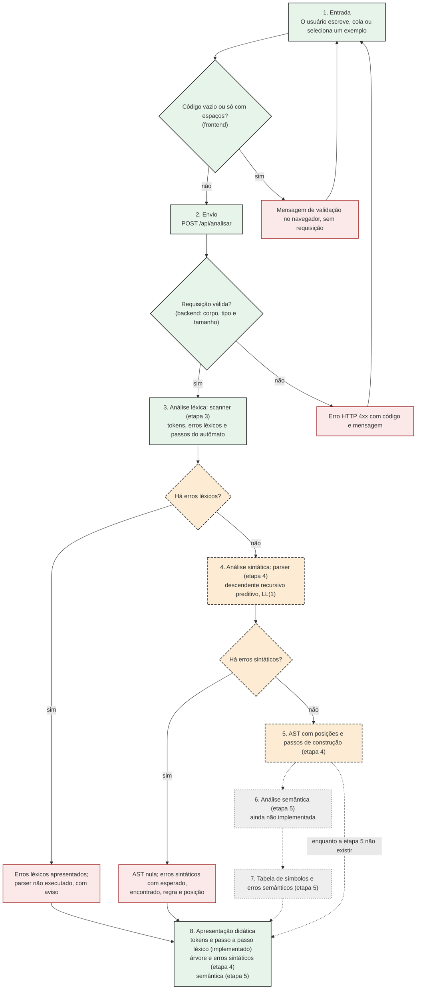

# Fluxograma do VisuLex

Fluxo do sistema, da entrada do código à apresentação dos resultados. É a mesma figura da seção Materiais e Métodos do artigo (Tarefa 4).

**Situação em 17/11/2026:** entrada, validação, scanner e apresentação dos resultados léxicos estão **implementados**. O parser e a AST estão **em desenvolvimento** (etapa 4). A análise semântica e a tabela de símbolos estão **previstas** para a etapa 5 e **ainda não existem**.

**Legenda:** verde com contorno contínuo = implementado; laranja tracejado = etapa 4, em desenvolvimento; cinza pontilhado = etapa 5, prevista; vermelho = ponto de retorno de erro ao usuário.

## Decisões representadas

- **Erros léxicos interrompem o fluxo antes do parser.** Uma lista de tokens com lacunas produziria erros sintáticos sem relação com o problema real. Os erros léxicos continuam sendo apresentados, e a interface avisa que a sintaxe será analisada depois da correção. Casos de teste: CT-L06 e CT-B09 ([casos-de-teste.md](casos-de-teste.md)).
- **Erros léxicos e sintáticos são apresentados separadamente.** Os léxicos continuam em `erros`; os sintáticos ficam em `sintatico.erros`.
- **Até a etapa 5, a AST vai direto para a apresentação.** A seta pontilhada que passa pela análise semântica só vale depois que ela for implementada.

O contrato previsto da resposta e o formato da AST estão descritos na seção Materiais e Métodos do artigo. O README só será atualizado com eles quando o parser estiver implementado e testado.
